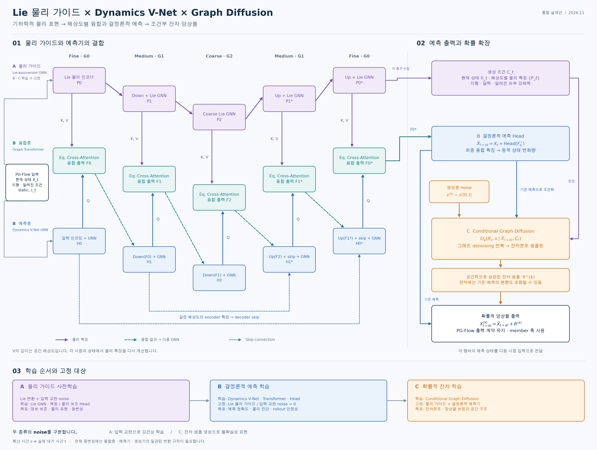

# graph_physics_climate

물리 가이드를 **그래프 단위**에서 설계하고, 그래프 신경망으로 기후·기상 상태를 예측하는 연구 코드.
첫 구현은 설계안 [`Lie Physical Guide × Dynamics V-Net × Graph Diffusion`](docs/design/Lie_Dynamics_Diffusion_VNet_Design_KO.md)의
§12 최소 범위(Stage A + Stage B)와 Stage C 골격이다.



## 구성

| 단계 | 모듈 | 내용 |
|---|---|---|
| A | `gpclimate/models/lie_physical_gnn.py` | SO(2) gauge-equivariant Lie Physical GNN. 스칼라(T, z, q, …)와 접벡터(u, v)를 구분하고, Fine → Medium → Coarse → Medium → Fine에서 물리 특징 \(P_0, P_1, P_2, P_1^*, P_0^*\)를 만든다. 복원 + 물리 보조(와도·발산) head |
| B | `gpclimate/models/dynamics_vnet.py` | 3-해상도 Dynamics V-Net GNN. 각 해상도에서 GNN → 등변 graph-transformer cross-attention 융합 → 다음 GNN. 고정 \(\Delta t\) 변화량 head |
| C (골격) | `gpclimate/models/diffusion.py` | 결정론 예측의 조건부 잔차 diffusion(등변 graph denoiser), 앙상블 조립 |
| 기반층 | `gpclimate/geometry/`, `gpclimate/nn/` | 구면 게이지·평행이동, 다해상도 icosahedral 그래프, gauge conv, 등변 cross-attention |
| 계약 | `gpclimate/contracts/pgflow_kai.py` | PG-Flow(KAI 67채널, 121×240) ↔ 내부 표현 어댑터 |

설계안 절과 코드의 대응, 내린 결정, 남은 일은 [`docs/IMPLEMENTATION_NOTES_KO.md`](docs/IMPLEMENTATION_NOTES_KO.md)에 정리했다.

## 연결 저장소 위에 쌓은 방식

새로 짠 부분은 SO(2) 게이지 등변 계층과 모델 조립이고, 나머지는 프로젝트에 연결된 fork의 코드를 그대로 사용한다.
고정 커밋과 용도는 [`third_party/README.md`](third_party/README.md) 참고.

- **physicsnemo**: GraphCast icosahedral 메쉬 계층(`icosahedral_mesh.py`), 좌표 변환(`graph_utils.py`)
- **LieConv**: `SO2` Lie group(`log`, `lifted_elems`)으로 edge별 평행이동 각도·방향 계산, `Swish`
- **lie-transformer**: `MultiheadLinear`로 cross-attention의 위치 커널(LieTransformer 방식)
- **graphtransformer**: Graph Transformer 레이어 구조(Q/K/V/E, edge 변조, clamp, O, FFN)를 PyG로 재구성(원본은 DGL)
- **pytorch_geometric**: `MessagePassing`, `MLP`, `softmax`, `scatter`
- **e3nn**: radial basis(`soft_one_hot_linspace`), radial MLP(`FullyConnectedNet`)
- **weatherbench2**: 평가 지표(RMSE, CRPS, 앙상블 평균 RMSE, spread)와 공개 ERA5 64×32 데이터
- neuralgcm, dinosaur: JAX 기반이라 이번 PyTorch 런타임에는 쓰지 않았다(스펙트럴 물리 진단 후보)

## 설치

```bash
git clone https://github.com/nayehyeon61-glitch/graph_physics_climate
cd graph_physics_climate
bash scripts/setup_env.sh      # submodule(LieConv, lie-transformer, physicsnemo, weatherbench2, graphtransformer) + pip
# 또는 fork들을 나란히 clone해 둔 디렉터리를 지정: export GPC_REPOS_ROOT=/path/to/clones
```

## 테스트와 CPU 스모크 테스트

```bash
python -m pytest                                   # 기하·등변성·계약 테스트 (CPU, 수 초)
python scripts/smoke_test.py --fetch --ablation    # ERA5 소규모 부분집합으로 Stage A→B→C (CPU)
```

스모크 테스트 결과는 `reports/smoke_test.json`, 로그는 `reports/smoke_test.log`에 남긴다.
수십~수백 step의 CPU 학습이므로 파이프라인 동작·등변성·손실 감소를 확인하는 용도이며, 예측 성능을 입증하지 않는다.

### 본 학습 (2026-11-02, CPU 4코어, 약 1시간 45분)

ERA5 64×32, 2016–2017 학습 → 2019 테스트, 24시간 간격으로 5일 rollout. 자세한 표: [`reports/TRAIN_EVAL_2016_2019_KO.md`](reports/TRAIN_EVAL_2016_2019_KO.md), 재현: `bash scripts/run_pipeline.sh`.

- 24시간 RMSE가 persistence보다 35–60% 낮고 5일까지 persistence·기후값 아래로 유지 (z500 1일 239, 5일 771 vs persistence 566/1007 m²/s²)
- 물리 가이드 유무 차이는 1–3일에서 1–3% (단일 seed, 파라미터 수 다름) → 결론 유보
- Stage C diffusion 앙상블의 CRPS는 독립 Gaussian 잡음 기준선과 같은 수준 (학습량 부족)

### 최근 스모크 테스트 (2026-11-02, CPU 4코어, 약 10분)

ERA5 64×32, 24시간 lead, 테스트 2020년 1월 12 사례. 자세한 표: [`reports/SMOKE_TEST_KO.md`](reports/SMOKE_TEST_KO.md).

- 모든 모듈의 게이지 등변성 상대오차 ≤ 4e-7 (float32 수준)
- 결정론 예측 RMSE가 persistence보다 낮음 (z500 426 vs 591 m²/s², t850 1.86 vs 2.80 K)
- guide 없는 비교 모델과의 차이는 작아 이 규모로는 결론 불가
- Stage C 앙상블은 학습량이 부족해 아직 결정론 예측보다 나쁨
