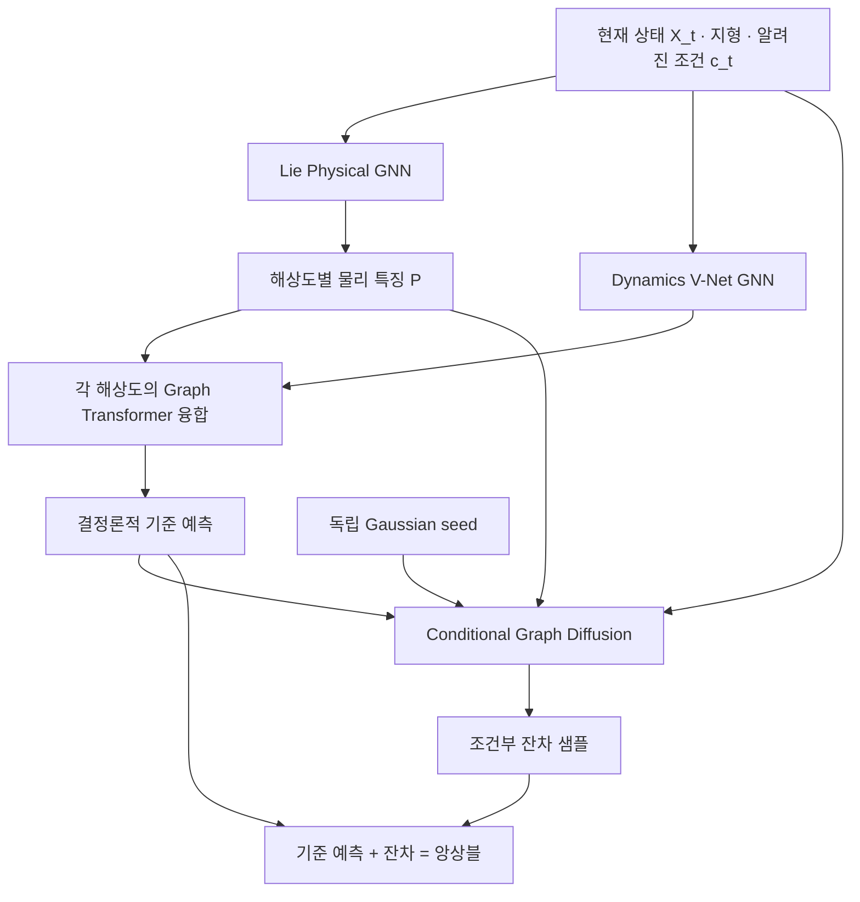

# Lie Physical Guide × Dynamics V-Net × Graph Diffusion 설계안

작성일: 2026-11-02  
문서 상태: 구현 전 연구 설계안. 아래 구조의 성능과 물리적 일관성은 아직 실험으로 검증하지 않았다.

## 1. 목표와 핵심 구성

ERA5 대기 상태를 입력받아 다음 시점의 상태와 확률적 앙상블을 예측한다. 기존의 **상단 물리 가이드–중간 Graph Transformer 융합층–하단 Dynamics V-Net GNN** 배치를 유지하고, 최종 예측 뒤에 **조건부 잔차 생성기**를 연결한다.

물리 가이드를 먼저 학습한 뒤 예측기와 융합층을 학습하는 기존 두 단계를 유지한다. 여기에 결정론적 예측의 잔차분포를 학습하는 세 번째 단계를 추가한다.

| 구성 요소 | 담당 역할 | 주요 출력 |
|---|---|---|
| Lie-equivariant Physical GNN | 기하학적으로 일관된 물리 표현 추출 | 해상도별 물리 특징 \(P_\ell\) |
| Dynamics V-Net GNN | 여러 공간 규모의 상호작용과 결정론적 상태 변화 학습 | 예측 특징 \(H_\ell\) |
| Equivariant Graph Transformer | 물리 특징을 예측 특징에 주입 | 융합 특징 \(F_\ell\) |
| Deterministic Head | 최종 융합 특징을 다음 상태로 변환 | 기준 예측 \(\bar X_{t+\Delta t}\) |
| Conditional Graph Diffusion | 기준 예측의 조건부 잔차분포 학습 | 잔차 샘플 \(R^{(k)}\) |
| Ensemble Assembly | 기준 예측과 생성 잔차 결합 | 앙상블 \(X_{t+\Delta t}^{(k)}\) |

**역할 구분**

- Lie GNN: 표현과 기하학적 일관성.
- Dynamics V-Net + Transformer: 결정론적 예측.
- Graph Diffusion: 조건부 잔차분포와 앙상블 생성.

이 구분은 모델링상의 역할 배분이다. 대기 물리가 실제로 서로 독립적인 세 성분으로 분해된다는 뜻은 아니다.

## 2. 전체 구조도

- [전체 구조도 PNG](https://chatgpt.com/library?file_id=libfile_c1de2528caf88191b60c472ffdb085f3&account_id=personal)
- [전체 구조도 SVG](https://chatgpt.com/library?file_id=libfile_f69e6164e07c81919f05877671560f84&account_id=personal)

아래 Mermaid는 모듈 사이의 관계를 요약한다. 실제 Transformer 융합은 V-Net의 각 해상도에서 반복된다.



### 2.1 기존 V 구조에 대한 대응

| 위치 | 구성 | 전달 방향 |
|---|---|---|
| 위쪽 V | Lie Physical GNN | Fine → Medium → Coarse → Medium → Fine |
| 가운데 V | Equivariant Graph Transformer | 각 해상도의 물리 특징과 예측 특징 융합 |
| 아래쪽 V | Dynamics GNN | 융합 결과를 받아 다음 해상도의 예측 특징 계산 |
| 오른쪽 출력 | Deterministic Head | 최종 융합 특징 → 기준 예측 |
| 오른쪽 확률 분기 | Conditional Graph Diffusion | 기준 예측과 물리 특징 → 잔차 샘플 → 앙상블 |

V의 깊이는 **공간 해상도**를 나타낸다. 실제 시간 진행이나 확산 시간 진행을 의미하지 않는다.

### 2.2 기호

| 기호 | 의미 |
|---|---|
| \(X_t\) | 현재 대기 상태 |
| \(c_t\) | 지형, 달력, 알려진 외부 강제력 등 조건 |
| \(\mathcal G_\ell\) | 해상도 \(\ell\)의 구면 그래프 |
| \(P_\ell\) | 물리 가이드의 특징 |
| \(H_\ell\) | Dynamics GNN의 예측 특징 |
| \(F_\ell\) | Transformer 융합 결과 |
| \(\bar X_{t+\Delta t}\) | 결정론적 기준 예측. 정확한 조건부 평균임을 보장하지 않음 |
| \(R_0\) | 학습 데이터에서 계산한 깨끗한 잔차 |
| \(R_s\) | 생성 시간 \(s\)에서 잡음이 추가된 잔차 |
| \(R^{(k)}\) | 생성한 \(k\)번째 잔차 샘플 |
| \(t,\Delta t\) | 실제 대기 시간과 예측 간격 |
| \(s\) | 확산 또는 생성 과정의 인공적인 시간 |

## 3. Stage A — Lie Physical GNN 사전학습

### 3.1 목적

물리 데이터로부터 예측에 활용할 표현을 학습한다. 미래 상태를 직접 예측하는 기능을 필수로 부여하지 않고, 물리 변수 복원과 물리적 보조 과제를 통해 정보가 보존된 표현을 얻는다.

사전학습에서는 유효한 Lie 변환과 입력 교란 잡음을 사용한다.

\[
\widetilde X_t=T_g(X_t)+\sigma L\epsilon,
\qquad
\epsilon\sim\mathcal N(0,I).
\]

\[
\{P_0,P_1,P_2,P_1^*,P_0^*\}
=
E_\theta(\widetilde X_t,T_g(c_t),\mathcal G,\sigma).
\]

- \(T_g\): 정의한 좌표계 또는 대칭 변환.
- \(L\): 변수별 잡음 크기와 공분산 구조를 정하는 연산자.
- \(\sigma\): 입력 교란 강도. 0을 포함해 학습하고 모델에 조건으로 제공한다.
- 별표는 decoder 쪽에서 복원한 특징을 뜻하며 시간 인덱스가 아니다.

좌표계 변환에 반응하는 조건은 입력과 함께 변환한다. 지형 높이와 같은 스칼라는 국소 좌표축 회전에서 값이 바뀌지 않지만, 지형 경사와 같은 벡터 표현은 해당 변환 규칙을 따라야 한다.

### 3.2 첫 구현에서의 Lie 구조

첫 구현은 구면 위 국소 접평면의 좌표축 선택에 일관적인 **\(SO(2)\) gauge-equivariant message passing**으로 제한한다.

- 온도·기압·비습 등은 스칼라로 취급한다.
- 수평 바람은 접평면의 2차원 벡터로 취급한다.
- 이웃 벡터 특징은 평행이동 연산자 \(P_{j\rightarrow i}\)로 같은 접평면에 옮겨 비교한다.
- 메시지 함수, 비선형성, 정규화 역시 표현의 변환 규칙을 따라야 한다.

\[
m_{ij}
=
\psi_\theta
\left(h_i,P_{j\rightarrow i}h_j,e_{ij}\right).
\]

평행이동을 사용했다는 사실만으로 임의의 메시지 함수가 등변적이 되는 것은 아니다. 함수의 구성에도 등변 조건이 필요하다.

국소 좌표계 선택의 일관성과, 고정된 지형·자전축·강제력을 그대로 둔 채 지구 전체를 임의로 회전시키는 물리 대칭은 구분한다. 또한 **정해진 Lie group에 대한 등변 네트워크**와 **새로운 물리 대칭군을 데이터에서 발견하는 네트워크**는 별도 과제다. 학습 가능한 generator 도입은 후속 실험으로 둔다.

### 3.3 학습 목표

\[
\mathcal L_A
=
\lambda_{\mathrm{rec}}\mathcal L_{\mathrm{rec}}
+
\lambda_{\mathrm{aux}}\mathcal L_{\mathrm{phys\text{-}aux}}
+
\lambda_{\mathrm{eq}}\mathcal L_{\mathrm{eq}}.
\]

| 항목 | 목적 |
|---|---|
| 복원 손실 | 잡음이 추가된 입력에서 깨끗한 물리 상태 복원 |
| 물리 보조 손실 | 정의한 물리 진단량, 국소 변화량 또는 물리 관계 학습 |
| 등변성 손실·진단 | 좌표계 변환 전후 특징의 일관성 확인 |

복원 목표는 원칙적으로 \(T_g(X_t)\)이다. **입력 교란 잡음은 제거하고 유효한 좌표계 변환은 유지**하도록 학습한다.

등변성 손실만 줄이면 상수 출력 같은 무의미한 표현도 가능하므로 정보 보존 과제가 필요하다. 구조적으로 등변성을 보장한 연산의 등변성 오차는 구현 검증 지표로 사용할 수 있다.

물리 보조 과제에 미래 관측을 사용하더라도 그것은 학습 목표일 뿐이다. 실제 추론의 조건 입력에는 미래 관측을 넣지 않는다.

## 4. Stage B — Dynamics V-Net과 Transformer 학습

### 4.1 학습 대상

- 고정: Stage A에서 학습한 Lie Physical GNN.
- 학습: Dynamics V-Net, 해상도별 Transformer, 최종 예측 Head.
- 초기 설정: Stage A의 입력 교란 잡음은 사용하지 않으며 \(\sigma=0\)으로 둔다.

고정되는 것은 물리 가이드의 **가중치**다. 물리 특징은 매 예측 시점의 현재 상태에서 다시 계산한다.

### 4.2 해상도별 전달

| 순서 | 그래프 | 물리 특징 | 예측 특징 | 융합 결과 |
|---|---|---|---|---|
| Encoder 0 | Fine \(G_0\) | \(P_0\) | \(H_0\) | \(F_0\) |
| Encoder 1 | Medium \(G_1\) | \(P_1\) | \(H_1\) | \(F_1\) |
| Bottleneck | Coarse \(G_2\) | \(P_2\) | \(H_2\) | \(F_2\) |
| Decoder 1 | Medium \(G_1\) | \(P_1^*\) | \(H_1^*\) | \(F_1^*\) |
| Decoder 0 | Fine \(G_0\) | \(P_0^*\) | \(H_0^*\) | \(F_0^*\) |

각 단계는 **GNN 계산 → 물리 특징과 융합 → 다음 GNN에 전달** 순서다. \(H_\ell\)과 \(F_\ell\)이 동시에 서로를 요구하는 순환 의존성을 만들지 않는다.

\[
F_\ell
=
H_\ell+
\beta_\ell
\operatorname{CrossAttention}_{\mathrm{eq}}
(Q=H_\ell,K=P_\ell,V=P_\ell).
\]

- Query: 예측 특징.
- Key·Value: 같은 해상도의 물리 특징.
- \(\beta_\ell\): 좌표계에 불변인 스칼라 게이트.
- 다른 노드 사이의 벡터 비교와 집계에는 필요한 평행이동을 적용한다.
- Attention 이후의 정규화·FFN도 등변 구조를 따라야 한다.

### 4.3 Forward 순서

다음 코드는 모듈 연결을 설명하는 의사코드다. 실행 가능한 구현은 아니다.

```python
P0, P1, P2, P1_up, P0_up = physical_guide(
    current_state, known_conditions, noise_sigma=0
)

H0 = gnn_0(lift(current_state, known_conditions))
F0 = fusion_0(query=H0, physics=P0)

H1 = gnn_1(down_01(F0))
F1 = fusion_1(query=H1, physics=P1)

H2 = gnn_2(down_12(F1))
F2 = fusion_2(query=H2, physics=P2)

H1_up = gnn_3(merge(up_21(F2), skip=H1))
F1_up = fusion_3(query=H1_up, physics=P1_up)

H0_up = gnn_4(merge(up_10(F1_up), skip=H0))
F0_up = fusion_4(query=H0_up, physics=P0_up)

delta_state = prediction_head(F0_up)
deterministic_forecast = current_state + delta_state
```

Pool·unpool은 그래프의 면적 가중과 벡터 표현의 평행이동을 고려한다. Encoder와 decoder 사이에는 같은 해상도의 skip connection을 둔다.

### 4.4 시간진화

첫 구현은 고정된 예측 간격에 대한 변화량을 출력한다.

\[
\bar X_{t+\Delta t}
=
X_t+\Delta X_\phi(X_t,\{P_\ell\},c_t,\Delta t).
\]

여기서 \(\Delta X_\phi\)는 이미 해당 시간 간격의 변화량이다. 순간 tendency로 정의하지 않았다면 다시 \(\Delta t\)를 곱하지 않는다.

연속시간 확장에서는 다음처럼 정의할 수 있다.

\[
\frac{dX}{dt}
=
F_{\mathrm{base}}(X,E_\theta(X,c),c)
+
F_{\mathrm{correction}}(X,E_\theta(X,c),c).
\]

이 경우 별도의 적분기와 안정성 검증이 필요하다. 적분기 내부에서도 현재 상태의 물리 특징을 재계산할지, 한 예측 간격 동안 고정할지 명시해야 한다. ODE solver 사용 자체가 물리 정확성을 보장하지 않는다.

### 4.5 물리 제약과 손실

\[
\mathcal L_B
=
\mathcal L_{\mathrm{forecast}}
+
\lambda_{\mathrm{phys}}\mathcal L_{\mathrm{phys}}
+
\lambda_{\mathrm{roll}}\mathcal L_{\mathrm{rollout}}.
\]

보존형 구조를 적용할 경우, 셀에 적분된 보존량 \(m_i\)에 대해 내부 플럭스를 반대칭으로 정의할 수 있다.

\[
\frac{dm_i}{dt}
=
-\sum_j\Phi_{ij}+S_i,
\qquad
\Phi_{ij}=-\Phi_{ji}.
\]

내부 edge를 통한 총량 이동은 상쇄되지만, 경계 플럭스와 외부 원천·흡수항은 별도 처리해야 한다. 셀 평균값을 다룬다면 면적·체적·층 질량에 해당하는 가중을 포함한다.

모든 출력 변수에 같은 보존식을 적용하지 않는다. 실제 관측의 물리 잔차에는 미해상 과정, 수치 이산화, 자료동화 등의 영향도 포함될 수 있으므로 무조건 0을 목표로 삼지 않는다.

가이드의 파라미터 동결과 입력에 대한 미분 차단은 다르다. 다단계 rollout 등에서 가이드 입력에 대한 gradient가 필요하면 이를 유지한다.

## 5. Stage C — Conditional Graph Diffusion 학습

### 5.1 목적과 고정 대상

Stage A와 B의 모델을 고정하고, 관측과 기준 예측 사이의 잔차분포를 학습한다.

\[
R_0
=
X_{t+\Delta t}^{\mathrm{ERA5}}
-
\bar X_{t+\Delta t}.
\]

잔차는 예측기와 같은 공간·채널 순서·단위 체계에서 계산한다. 필요하면 학습 데이터에서 추정한 잔차 스케일로 추가 정규화하고, 생성 후 정확히 역변환한다.

### 5.2 Forward diffusion과 denoiser

\[
R_s
=
\sqrt{\bar\alpha_s}R_0+
\sqrt{1-\bar\alpha_s}\epsilon,
\qquad
\epsilon\sim\mathcal N(0,I).
\]

\[
C_t=(X_t,\{P_\ell\},c_t).
\]

\[
\widehat\epsilon
=
D_\psi(R_s,s\mid\bar X_{t+\Delta t},C_t).
\]

\[
\mathcal L_C
=
\mathbb E_{t,s,\epsilon}
\left[
w(s)\,
\left\|
\epsilon-D_\psi(R_s,s\mid\bar X_{t+\Delta t},C_t)
\right\|_W^2
\right].
\]

\(W\)는 필요에 따라 공간 면적과 변수별 가중을 반영한다. Graph Denoiser는 잡음이 추가된 잔차의 공간 관계를 처리하며, 최종적으로 공간적으로 상관된 잔차분포를 학습하도록 한다. Graph 구조 자체가 올바른 공간 상관을 보장하지는 않으므로 별도 평가가 필요하다.

### 5.3 추론과 최종 출력

각 멤버마다 독립적인 초기 잡음을 사용하고 역확산 과정을 수행한다.

\[
R^{(k)}
=
\operatorname{SampleDiffusion}
(\epsilon^{(k)};\bar X_{t+\Delta t},C_t).
\]

\[
\boxed{
X_{t+\Delta t}^{(k)}
=
\bar X_{t+\Delta t}+R^{(k)}
}
\]

잔차에는 확률적 변동 외에 결정론적 예측기의 편향도 포함될 수 있다.

\[
\mathbb E[R\mid X_t]\neq 0
\]

일 수 있으므로 최종 앙상블 평균과 기준 예측은 일반적으로 다를 수 있다. 기준 예측을 보존하려는 목적만으로 잔차 평균을 강제로 제거하면 유용한 편향 보정까지 없앨 수 있다.

### 5.4 Residual flow matching 대안

기존 PG-Flow의 생성 학습 방식과 연결하려면 Graph Diffusion을 조건부 residual flow matching으로 대체하는 설계도 가능하다.

두 방식 모두 기준 예측을 조건으로 잔차를 생성할 수 있지만, 학습 목표와 sampling 식은 각각의 방식에 맞춰야 한다. 첫 구현에서 diffusion과 flow matching을 동시에 넣을 필요는 없다.

**잔차 생성용 ODE와 실제 대기 시간진화용 ODE는 서로 다른 연산이다.**

## 6. 두 종류의 noise 구분

| 구분 | Stage A의 입력 교란 | Stage C의 생성 잡음 |
|---|---|---|
| 목적 | 강건한 물리 표현 학습 | 잔차분포 샘플링 |
| 적용 대상 | 현재 상태 입력 | 잔차의 확산 과정 |
| 학습 목표 | 깨끗한 상태·물리 특징 복원 | 조건부 잔차분포 학습 |
| 초기 추론 설정 | \(\sigma=0\) | 멤버별 seed 사용 |
| 해석 | 학습용 augmentation | 앙상블 다양성의 출발점 |

두 잡음은 실제 대기 시간의 물리 SDE에 등장하는 \(dW_t\)와 자동으로 동일시할 수 없다. 물리 SDE를 사용하려면 별도로 drift, diffusion coefficient, 시간 간격에 따른 스케일 및 자료와의 대응을 정의해야 한다.

## 7. 전체 학습 순서

| 단계 | 학습 대상 | 고정 대상 | 핵심 목표 |
|---|---|---|---|
| A | Lie Physical GNN + 보조 Head | 없음 | 정보 보존, 물리 표현, 입력 잡음에 대한 강건성 |
| B | Dynamics V-Net + Transformer + Head | Lie Physical GNN | 결정론적 정확도, 물리 진단, rollout 안정성 |
| C | Conditional Graph Diffusion | A + B | 조건부 잔차분포와 앙상블 보정 |

권장 진행 순서:

1. 시간 기준으로 학습·검증·테스트 기간을 분리한다.
2. Stage A를 학습하고 복원 성능과 등변성 오차를 확인한다.
3. Stage B를 학습하고 일반 GNN 대비 물리 가이드의 기여를 확인한다.
4. 결정론적 모델을 고정한 뒤 잔차 데이터를 구성한다.
5. Stage C를 학습하고 단순 잡음 앙상블 대비 이득을 확인한다.
6. 세 단계의 기여가 확인된 뒤에만 선택적으로 공동 미세조정을 검토한다.

결정론적 모델이 학습한 사례의 잔차만 사용하면 일반화 상황의 잔차보다 작게 나타날 수 있다. 결정론적 모델이 보지 않은 별도 기간이나 시간 블록 교차검증으로 잔차 분포를 확인한다. 보정용 기간과 최종 테스트 기간은 구분한다.

공동 미세조정으로 기준 예측기가 바뀌면 잔차 목표도 바뀐다. 따라서 캐시된 잔차를 그대로 사용하는 방식과 양립하는지 확인해야 한다.

## 8. 다단계 앙상블 rollout

첫 시점은 관측 상태를 입력으로 사용한다. 이후에는 각 멤버의 예측 상태를 다음 입력으로 사용한다.

\[
P_t^{(k)}=E_\theta(X_t^{(k)},c_t,\sigma=0),
\]

\[
\bar X_{t+\Delta t}^{(k)}
=
\Phi_\phi(X_t^{(k)},P_t^{(k)},c_t),
\]

\[
X_{t+\Delta t}^{(k)}
=
\bar X_{t+\Delta t}^{(k)}
+
R_\psi^{(k)}
(\bar X_{t+\Delta t}^{(k)},X_t^{(k)},P_t^{(k)},c_t).
\]

멤버마다 현재 상태에 맞는 물리 특징과 기준 예측을 다시 계산한다. 공통 결정론적 궤적에 시점별 독립 잡음만 덧붙이는 방식과 구분한다.

이 구조도 올바른 장기 시간 상관을 자동으로 보장하지는 않는다. 필요한 경우 과거 상태 조건, trajectory 학습 또는 기억 구조를 추가하되 첫 모델에서는 별도 확장으로 관리한다.

## 9. PG-Flow 입출력 연결

외부 입출력 계약은 기존 PG-Flow를 따르고 내부 예측 모델을 교체한다.

| 경계 | 적용 원칙 |
|---|---|
| 입력 데이터 | 기존 dynamic state, static field, 날짜·알려진 조건을 동일한 순서로 사용 |
| 정규화 | 기존 학습 통계를 사용하고 정확한 역정규화를 유지 |
| 그래프 변환 | grid-to-graph와 graph-to-grid를 모델 내부 adapter로 구현 |
| 결정론적 출력 | 기존 예측 상태 형식으로 복원 |
| 앙상블 출력 | 기존 출력의 member 축에 멤버를 배치 |
| 정적장 | 예측 대상과 분리하고 출력 계약에 맞게 복사·조립 |
| 시간 정보 | 실제 \(\Delta t\), lead_time 단위, 날짜를 일치시킴 |

이 문서에서 채널 수나 예측 간격을 새로 확정하지 않는다. 구현 시 선택한 PG-Flow 브랜치의 데이터 계약과 exporter를 기준으로 고정한다. 원래 요청대로 입출력 호환성을 유지하되, 기존 물리 잔차 평가 코드가 새로운 다중 해상도 Lie 특징 추출기를 이미 제공한다고 가정하지 않는다.

정규화된 바람 두 성분을 서로 다른 스케일로 처리하면 일반적인 회전 규칙과 충돌할 수 있다. 내부 벡터 표현에는 공통 스케일을 사용하거나 정규화로 유도된 변환을 정확히 구현한다.

## 10. 검증 계획

| 비교 | 확인할 질문 |
|---|---|
| 일반 Dynamics GNN vs Lie guide를 추가한 모델 | 물리 가이드가 예측에 도움이 되는가? |
| 동일 용량의 일반 가이드 vs 등변 가이드 | Lie 구조 자체의 기여가 있는가? |
| Stage A 입력 noise off vs on | 교란 학습이 강건성과 예측에 도움이 되는가? |
| 단순 결합 vs Transformer 융합 | 학습된 융합층의 추가 이득이 있는가? |
| 단일 해상도 vs V-Net | 여러 공간 규모의 처리가 필요한가? |
| 결정론적 모델 + Gaussian/저랭크 잡음 vs Graph Diffusion | 생성기의 추가 비용에 상응하는 확률예측 이득이 있는가? |

평가 항목:

- 결정론적 예측: 면적 가중 RMSE, 변수·고도·lead별 성능.
- 기하학적 일관성: 국소 좌표계 회전 전후 등변성 오차.
- 물리 진단: 정의한 질량·수분·에너지 budget, 원천항을 포함한 물리 잔차.
- 확률 예측: CRPS, ensemble mean RMSE, spread–skill, rank histogram.
- 공간·시간 구조: 공간 상관, 파워 스펙트럼, 궤적 연속성.
- 효율: 파라미터 수, GPU 메모리, 학습 비용, 멤버당 추론 시간.

모델별 ensemble size와 계산 예산을 함께 보고한다. 장기 기후 모델로 확장하려면 단기 예측 지표 외에 장기 drift, 계절 통계, 극한값 빈도 및 강제력 반응을 별도 평가해야 한다.

## 11. 구현 시 주의점

1. **등변성의 범위:** 상단 Lie GNN뿐 아니라 융합층, pool·unpool, 출력층, 생성기에도 일관된 변환 규칙이 필요하다.
2. **확률적 등변성:** 생성 분포의 등변성과 개별 샘플의 일치 검증을 구분한다. 샘플별 비교에서는 동일한 seed의 잡음도 해당 표현에 맞게 변환해야 한다.
3. **물리 제약의 범위:** 구조에 정확히 반영한 제약과 손실로 유도한 제약을 구분한다.
4. **잔차 추가 후 물리성:** 기준 예측이 제약을 만족해도 잔차를 더하면 깨질 수 있다. 최종 멤버에 대해 물리 진단을 수행한다.
5. **정보 누수:** 미래 관측은 학습 목표와 평가에만 사용한다. 추론 조건에는 현재 상태와 당시 이용 가능한 정보만 넣는다.
6. **실제 시간과 생성 시간:** 대기 시간 \(t\)와 확산 시간 \(s\)를 코드·설정·로그에서 분리한다.
7. **물리 역할의 해석:** Lie 구조가 단순히 “매끄러운 현상”만 처리하고 Dynamics가 “거친 현상”만 처리한다고 해석하지 않는다. 구분 기준은 대칭·표현, 시간진화, 조건부 분포다.
8. **연구 주장:** 결정론적 예측과 잔차 생성의 조합 자체를 새로운 것으로 주장하지 않는다. 물리 표현과 융합 구조의 추가 기여를 비교 실험으로 입증한다.

## 12. 최소 구현 범위와 확장 순서

첫 구현 범위는 **Stage A + Stage B**다.

- 저해상도 구면 그래프.
- 스칼라·접벡터를 구분하는 물리 가이드.
- 3개 공간 해상도의 Dynamics V-Net.
- 각 단계의 물리 특징 융합.
- 고정된 예측 간격의 결정론적 변화량 출력.
- 기존 PG-Flow 입출력 계약 유지.

결정론적 성능과 물리 가이드의 기여를 확인한 뒤 **Stage C**를 추가한다.

학습 가능한 Lie generator, 물리시간 SDE, 기억 구조, 공동 미세조정, 고해상도 확장은 각각 분리된 후속 실험으로 둔다.

## 13. 관련 연구와 역할

아래 자료는 구성 요소의 설계 근거이며, 본 문서의 전체 결합 모델이 검증되었다는 의미는 아니다.

1. **Gauge Equivariant Mesh CNNs**  
   국소 좌표계 일관성과 평행이동을 이용한 기하학적 메시지 전달.  
   https://maurice-weiler.gitlab.io/publication/2020_03_mesh_cnns/

2. **Graph Neural PDE Solvers with Conservation and Similarity-Equivariance**  
   GNN에 보존 구조와 물리 대칭을 반영하는 접근.  
   https://proceedings.mlr.press/v235/horie24a.html

3. **ArchesWeather & ArchesWeatherGen**  
   결정론적 예측과 생성형 잔차를 결합하는 기상 예측 접근.  
   https://arxiv.org/abs/2412.12971

4. **PG-Flow 저장소**  
   본 설계에서 입출력 계약을 연결할 사용자 프로젝트. 실제 구현 기준 브랜치와 commit은 구현 시작 시 명시한다.  
   https://github.com/nayehyeon61-glitch/physical_guide_flowmatching

